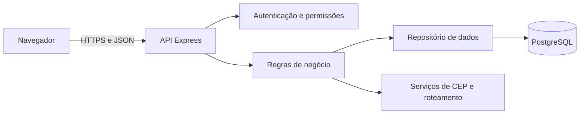

# Arquitetura da solução

## Visão geral

O UrbanLink Flow utiliza uma arquitetura web em três camadas. O navegador apresenta a interface e consome a API REST. O servidor Node.js aplica validações, autenticação, permissões e regras de negócio. A camada de repositório isola o PostgreSQL e permite executar a aplicação em memória durante demonstrações locais.

## Componentes

- `public`: interface institucional, autenticação e painel operacional.
- `src/app.js`: rotas HTTP, tratamento de erros e integração das regras.
- `src/validation.js`: contratos de entrada com Zod.
- `src/middleware`: autenticação JWT e autorização por perfil.
- `src/services`: CEP, roteamento viário e algoritmo de otimização.
- `src/repositories`: persistência em memória ou PostgreSQL.
- `database`: migrations e dados iniciais.

## Segurança

- Senhas protegidas com bcrypt.
- Tokens JWT com validade configurável.
- Permissões verificadas no servidor.
- Consultas SQL parametrizadas.
- Limitação de tentativas no login.
- Cabeçalhos de segurança por Helmet.
- Segredos fornecidos por variáveis de ambiente.

## Decisões técnicas

PostgreSQL foi adotado para a publicação porque o Render oferece instância gerenciada gratuita por 30 dias. O modo em memória permanece disponível para apresentação offline. A camada de repositório desacopla a API do banco e traduz o contrato da aplicação para o esquema físico em português.
