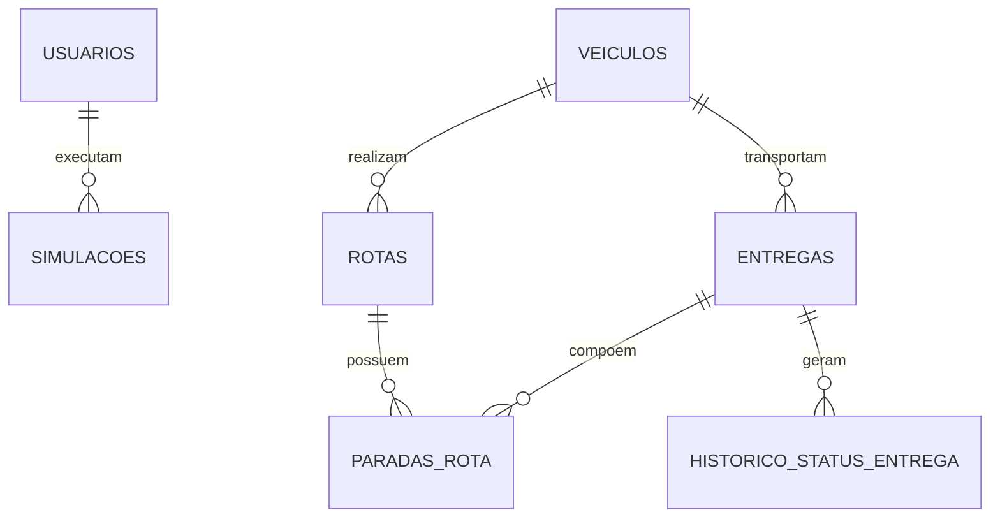

# Modelagem de dados UrbanLink Flow

## Modelo conceitual

Um usuário executa simulações e, conforme seu perfil, administra entregas, veículos e rotas. Um veículo pode transportar várias entregas e realizar diversas rotas. Uma rota contém paradas ordenadas e cada parada referencia uma entrega. Toda alteração do status de uma entrega gera um registro de histórico.

## Modelo lógico

| Tabela | Finalidade | Chaves e restrições principais |
|---|---|---|
| `usuarios` | autenticação e autorização | e-mail único e perfil controlado |
| `veiculos` | cadastro e disponibilidade da frota | placa única e capacidade positiva |
| `entregas` | solicitação e acompanhamento | código único e veículo opcional |
| `rotas` | planejamento operacional | veículo opcional e nível de serviço válido |
| `paradas_rota` | ordem das entregas em uma rota | rota e entrega obrigatórias; ordem única por rota |
| `simulacoes` | cenários e indicadores calculados | usuário executor opcional e parâmetros em JSONB |
| `historico_status_entrega` | trilha de auditoria | entrega obrigatória e data automática |

## Modelo físico

O arquivo `database/migrations/001_esquema.sql` implementa o modelo em PostgreSQL. Todos os identificadores de domínio estão em português, sem acentos e em `snake_case`.

Latitude e longitude são mantidas porque são termos técnicos usados por bibliotecas cartográficas. O usuário informa CEP e endereço; as coordenadas são obtidas automaticamente.

## Normalização

- Primeira forma normal: os atributos são atômicos e as paradas ficam em tabela própria.
- Segunda forma normal: todos os atributos dependem integralmente da chave primária.
- Terceira forma normal: usuários, veículos, entregas, rotas e simulações não repetem dados de outras entidades.
- Integridade referencial: chaves estrangeiras usam exclusão em cascata ou definição como nulo conforme a regra de negócio.
- Integridade de domínio: restrições `CHECK` controlam perfis, tipos, prioridades, estados e intervalos numéricos.

## Índices e automações

- Índice composto em status e prioridade de entregas.
- Índice de agendamento para consultas operacionais.
- Índices de status em veículos e rotas.
- Gatilho `gatilho_historico_status_entrega` para auditoria.
- Gatilho `atualizar_data_modificacao` para manter datas de atualização.
